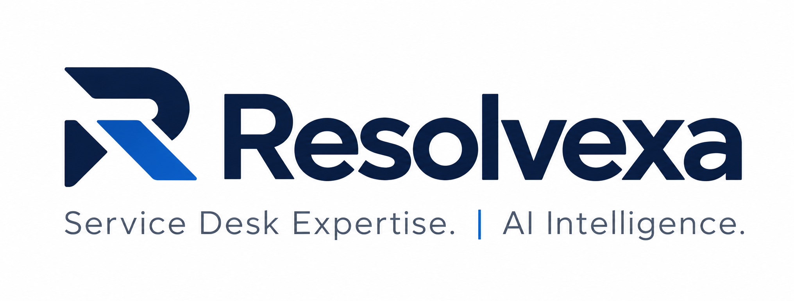
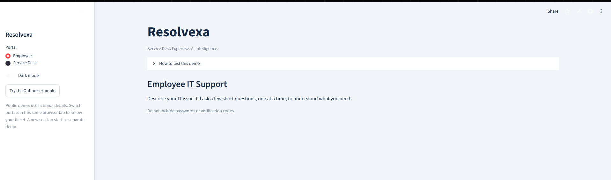

# Resolvexa

<picture>
  <source media="(prefers-color-scheme: dark)" srcset="resolvexa_dark.png">
  <source media="(prefers-color-scheme: light)" srcset="resolvexa_logo.png">
  
</picture>

**Service Desk Expertise. AI Intelligence.**

I built Resolvexa to apply AI to a problem I encounter in Service Desk: tickets often arrive without enough detail to begin troubleshooting. The application helps employees explain their issue, gathers relevant information through follow-up questions, and carries that context into a technician workspace.

This project demonstrates how I turn a real support workflow into a working AI-assisted application using Python, API integration, and database-backed ticket management.

[Try the live application](https://aiservicedesk.streamlit.app/)

## Application Preview

## What I Built

- **Conversational intake:** Employees describe an issue in their own words and answer relevant follow-up questions one at a time.
- **Guided self-service:** Step-by-step help for common tasks, including password resets and mapping network drives.
- **Structured ticket creation:** Employee answers and attempted troubleshooting steps become context for the Service Desk.
- **Technician workspace:** Ticket review, assignment, status updates, internal notes, and resolution tracking.
- **AI-assisted troubleshooting:** Technicians receive one troubleshooting step at a time and record the outcome before continuing.
- **Activity and audit history:** A rolling 24-hour activity display with separate ticket audit records.

## Skills Demonstrated

- **AI integration:** Connecting a Python application to a hosted language model through the GroqCloud API.
- **Prompt design:** Giving the model task-specific instructions for intake, ticket analysis, and Tier 1 troubleshooting.
- **Workflow automation:** Connecting employee intake, self-service outcomes, ticket creation, and technician follow-up.
- **Application development:** Building interactive employee and technician interfaces with Streamlit and maintaining state across interactions.
- **Data management:** Using SQLite to store tickets, troubleshooting outcomes, notes, and audit records.
- **Error handling:** Managing API timeouts, connection failures, request cooldowns, and a ticket creation fallback when AI is unavailable.
- **Deployment:** Publishing a working application through GitHub and Streamlit Community Cloud.

## Explore the Workflow

Open the live application and select **Try the Outlook example**, or describe a fictional IT issue in the **Employee** portal. Answer the follow-up questions and try the available guidance. If the issue remains unresolved, generate a ticket and switch to **Service Desk** in the same browser tab to see the handoff and continue troubleshooting.

Please use fictional information. This public portfolio demo uses session-scoped tickets and temporary cloud storage.

## Tech Stack

**Python · Streamlit · SQLite · GroqCloud API · Requests · GitHub · Streamlit Community Cloud**

## Ongoing Development

I am continuing to refine the intake questions, self-service guidance, and technician workflow through testing. The focus is practical: make it easier for employees to explain what they need and give technicians useful context from the start.
